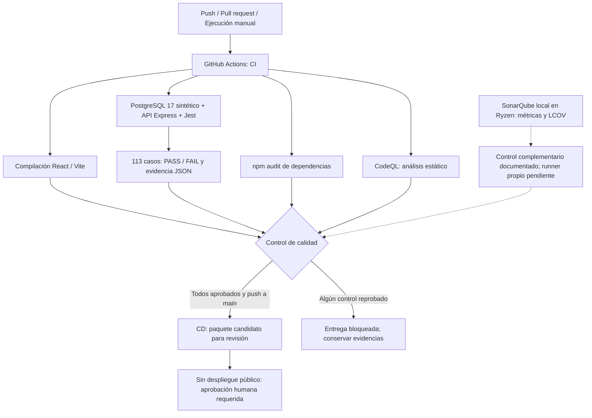

# EP5 · Punto 3.2 — Integración CI/CD con controles automatizados

**Proyecto:** Cuidarte+ · ISY1102 · Fecha de implementación: 22-11-2026.  
**Estado:** Pipeline ejecutable definido en `.github/workflows/ep5-ci-cd.yml`; verificar la primera ejecución en GitHub Actions.  
**Alcance:** repositorio de laboratorio, código fuente intencionalmente vulnerable sin modificaciones, datos exclusivamente sintéticos.

## Diagrama de integración

**Interpretación:** este flujo automatiza integración y promoción condicionada de un artefacto candidato. **No despliega Cuidarte+ a producción**: se conocen defectos críticos de autorización y confidencialidad y la finalidad es una auditoría de laboratorio. El flujo de SonarQube local está señalado explícitamente como **no integrado aún a GitHub Actions**.

## Controles reales

| Etapa | Control ejecutado | Evidencia y criterio |
|---|---|---|
| Build | Node.js + `npm ci` + `npm run build` en FRONTEND | Compilación exitosa o fallo visible |
| QA | PostgreSQL 17 con `cuidarteplus_qa`, marcador `CUIDARTE_QA_PUBLIC_20261028`, backend local y Jest | Archivo JSON de Jest, 113 pruebas actuales, estado final del job |
| Dependencias | `npm audit --omit=dev --audit-level=high` en BACKEND, FRONTEND y QA | Informes JSON; aviso alto/crítico hace fallar la etapa |
| SAST | GitHub CodeQL sobre JavaScript/TypeScript | Resultados de seguridad en GitHub (sujeto a que el repositorio permita Code Scanning) |
| Puerta de entrega | `needs` de jobs CI y rama `main` | No se promociona artefacto si hay fallos |
| CD interno | Copia del build a un artefacto `release-candidate` revisable | No hay despliegue externo ni aprobación automática de seguridad |

## Trazabilidad normativa (controles técnicos, no certificación legal)

| Referencia | Riesgo asociado | Control relacionado |
|---|---|---|
| Ley 19.628, protección de datos personales | Divulgación de información sensible | Jest T-02 y revisiones de seguridad; defectos reportados |
| Ley 20.584, ficha clínica | Pérdida, acceso indebido o falta de conservación | Jest T-02/T-03 y controles de integridad |
| ISO/IEC 27002:2022 | Accesos, registros y controles de seguridad | Jest T-01/T-04/T-12/T-22/T-23, auditoría de dependencias y CodeQL |
| ISO/IEC 25010:2023 | Fiabilidad, seguridad y mantenibilidad | Build, suite Jest, evaluación de resultados y SonarQube local |
| ISO/IEC/IEEE 29119 | Evidencia, ejecución y comunicación de pruebas | JSON, logs, trazabilidad PASS/FAIL y artefactos de GitHub |

Estas referencias **no prueban conformidad normativa ni evitan que las vulnerabilidades existan**. Se utilizan como criterios para diseñar controles y explicar hallazgos. La correspondencia final con requisitos del ERS debe verificarse contra los códigos exactos entregados por el docente.

## Comportamiento esperado del pipeline

En el laboratorio del 22-11-2026, Jest registró **94 PASS y 19 FAIL de 113**. En GitHub Actions, cualquier FAIL es un incumplimiento efectivo del control y el job queda rojo. **No cambiar las aserciones, no usar `|| true` para ocultar el resultado, no corregir el código vulnerable.** Los reportes sí se conservan mediante `if: always()` para la documentación. Un resultado verde futuro solo es aceptable si las comprobaciones ejecutadas realmente aprueban.

## Cómo verificar

1. Abrir **GitHub → Actions → EP5 CI/CD · seguridad y calidad**, o abrir la ejecución asociada a la rama `ep5/ci-cd-seguridad-20261122`.
2. Revisar Build, Jest/PostgreSQL, auditorías npm y CodeQL; descargar artefactos de evidencia.
3. Capturar ejecución mostrando estado global, jobs, número de pruebas y motivos de bloqueo.
4. Verificar que el job **Promoción de artefacto candidato** no se ejecute si las pruebas o los controles fallan.
5. Para integrar también SonarQube local, instalar/configurar un runner propio aislado en Ryzen con acceso a `127.0.0.1:9000`, sin publicar SonarQube en Internet. No se afirma como realizado hasta certificar la ejecución.

## Límites y resguardos

- **Se ejecuta solamente en GitHub Actions**, con PostgreSQL efímero y datos ficticios. No usa la PostgreSQL del Ryzen.
- No introducir tokens de SonarQube, credenciales personales ni datos clínicos reales en el repositorio o logs.
- No habilitar despliegue de Cuidarte+ vulnerable a Internet.
- No interpretar un escaneo de dependencias ni CodeQL como sustitutos de pruebas de autorización y confidencialidad.
- Mantener distinguido lo ejecutado localmente (Jest, SonarQube, Burp, etc.) de lo que se ejecuta en CI.
